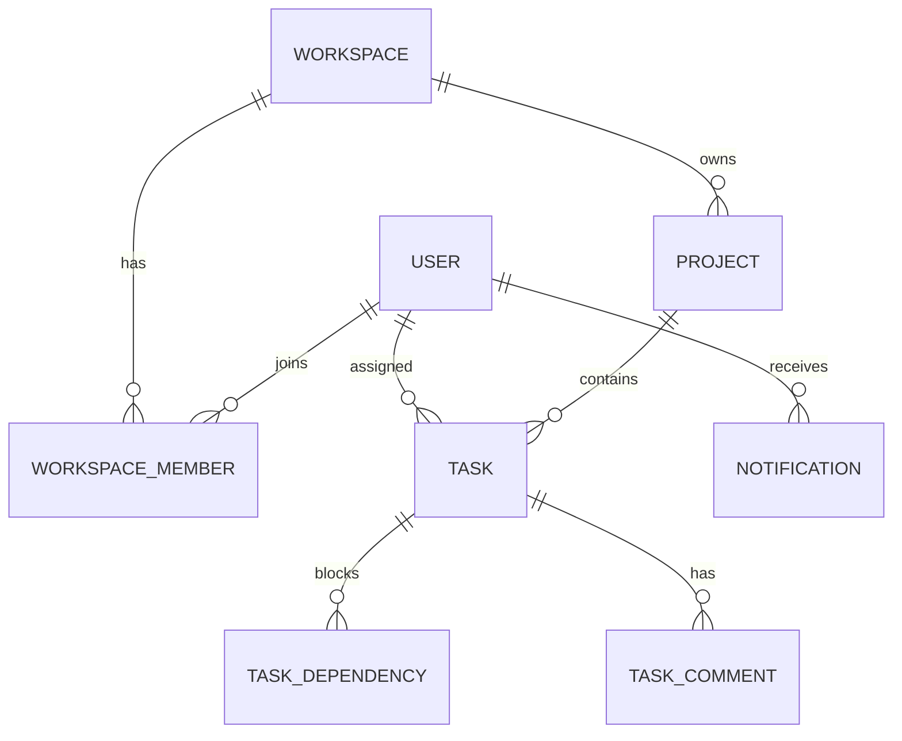

# WorkOS

WorkOS is a production-style team workflow application built to demonstrate secure full-stack SaaS patterns. It supports account registration, workspace-scoped collaboration, role-aware project and task workflows, dependency validation, activity history, persistent notifications, and a responsive Kanban experience.

## Architecture

The React/Vite application uses TanStack Query for API data and dnd-kit for the board. The Express API uses Prisma and PostgreSQL, Zod validation, HTTP-only JWT cookies, Helmet, CORS, rate limits, and resource-level role checks.

## Run locally

1. Copy `.env.example` to `.env` and replace `JWT_SECRET`.
2. Start PostgreSQL: `docker compose up -d`.
3. Install packages: `npm install`.
4. Create schema/client: `npm run db:generate && npm run db:migrate`.
5. Seed a realistic workspace: `npm run db:seed`.
6. Start both apps: `npm run dev`.

Open `http://localhost:5173`. The API is available at `http://localhost:4000`.

Demo account: `member@workos.demo` / `DemoPass123!` (development-only seed credentials).

## Commands

| Command | Purpose |
|---|---|
| `npm run dev` | Client and API development servers |
| `npm run build` | Type-check and produce production builds |
| `npm run test` | Run API and UI test suites |
| `npm run db:migrate` | Apply Prisma migrations |
| `npm run db:seed` | Populate the demo workspace |

## API surface

Versioned endpoints live under `/api/v1`: authentication (`/auth/*`), workspace dashboard and projects (`/workspaces/:workspaceId/*`), project tasks (`/projects/:projectId/tasks`), task updates/dependencies/comments (`/tasks/:taskId/*`), notifications, and analytics. All workspace access is checked from the authenticated user’s membership; client-supplied role or ownership values are not trusted.

## Deliberate scope notes

The application includes the data model for invitations, password reset tokens, analytics, activity and notifications. SMTP delivery and the scheduled reminder runner are deployment integrations: configure them as a dedicated worker/cron in the production environment. The core notification persistence and duplicate-prevention key are ready for that worker. For production, rotate JWT secrets, require HTTPS, set a fixed allowed origin, and add CSRF tokens if cross-site cookie usage is enabled.
